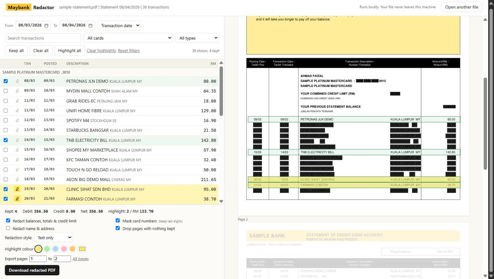

# maybank-redactor

Pick the transactions you need to show, and every other transaction gets redacted, all locally on your own machine. Keep and highlight only what you need.



*Screenshots use a generated sample statement. All names, card numbers and transactions are fake.*

## Run

```
pip install -r requirements.txt
python server.py
```

Needs Python 3.9+ (tested on 3.14) and PyMuPDF 1.27+. Opens http://127.0.0.1:3090/ in the browser. On Windows, `run.bat` does the same.

You also can try it with the fake one in `demo/sample-statement.pdf`, or regenerate it with `python demo/make_sample.py`.

## How it works

- **Local only.** A small `http.server` bound to `127.0.0.1`. Uploaded PDFs are kept in memory, never written to disk, and nothing loads from a CDN.
- **Parsing.** Reads the PDF text layer with PyMuPDF and groups words into lines by position. A transaction row is two `dd/mm` dates on the left plus an amount on the right. Continuation lines (e.g. `TRANSACTED AMOUNT USD 19.99`) attach to the row above. Also picks up card section headers, balances/totals, and the name/address block.
- **True redaction.** Uses `apply_redactions`, so the text under each box is removed from the file, not just covered with a black rectangle that can still be copied out.
- **Cross-check.** The parser only redacts rows it recognises, so it checks itself: the rows it found must add up to the TOTAL DEBIT / TOTAL CREDIT printed for each card, and any dated line it could not read is flagged. Either case shows a warning to check the preview before sending.
- **Output check.** The exported PDF is re-opened and checked both ways: no words left under any box (otherwise the export fails), and every word outside the boxes still present (otherwise a warning).
- **Clean copy.** The output is a fresh file holding only the page content: no annotations, form fields, links, bookmarks, metadata or original file ID. Images under a box are blanked. Output is unencrypted, even if the input was password-protected.
- **Highlight.** Drawn underneath the page content, so text stays black on the marker colour.

## Features

- Filter by date range (transaction or posting date), card, debit/credit, or text search
- Tick rows to keep; every other transaction gets redacted
- Highlight rows, with a choice of colour
- Redaction style: text only, or full-row blocks (also hides text length)
- Optional: redact balances and totals, mask card numbers (last group kept), redact name and address
- Export a page range, and drop pages that have nothing kept

## Limitations

Built for Maybank credit card statements only. Other banks, and Maybank savings/current account statements, use different layouts and probably won't parse.
